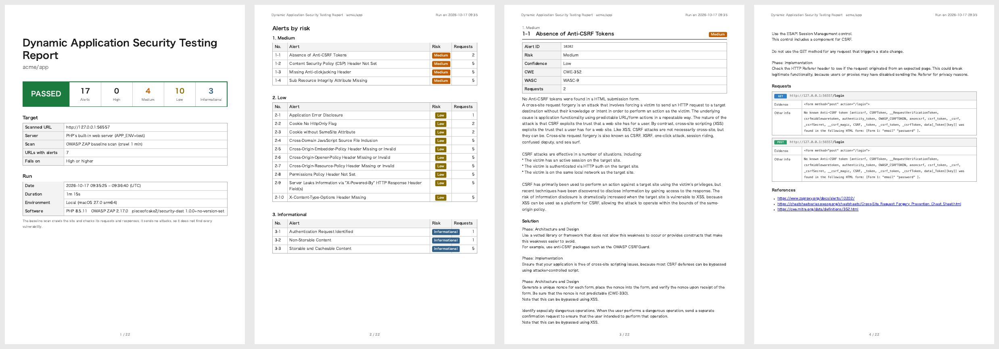

# Security DAST Documentation

Dynamic application security testing (DAST) of a CakePHP 2 application: the application is run, crawled and
checked by the baseline scan of [OWASP ZAP](https://www.zaproxy.org/), for the issues that its responses show,
such as missing security headers, cookies without flags, forms without a CSRF token or error pages with debug
information. The alerts are written as an A4 PDF report by risk, in the design of the reports of
[pieceofcake2/report](https://pieceofcake2.github.io/report/). The exit code fails CI when an alert reaches a
risk.

- [Alerts](alerts.md): what each alert means, and how to fix it in a CakePHP 2 application
- [CI with GitHub Actions](ci.md)

It is one of the security checks of pieceofcake2, with
[pieceofcake2/security-sca](https://pieceofcake2.github.io/security-sca/) (the known vulnerabilities of the
Composer packages) and [pieceofcake2/security-sast](https://pieceofcake2.github.io/security-sast/) (the source
code); pieceofcake2/security-check runs them all.

## How It Works

1. The application of the project is started with PHP's built-in web server on `127.0.0.1`, with
   `APP_ENV=test`, so that it loads `config/.env.test` and uses the database of the tests. The document root
   comes from the application (`WWW_ROOT` of `config/define.php`, or `webroot/` or `app/webroot/` of the
   legacy layout), and a router script sends the requests to `index.php` as `webroot/.htaccess` does.
2. ZAP runs in Docker (`ghcr.io/zaproxy/zaproxy:stable`) with `zap-baseline.py`: it crawls the site for a
   minute (`--minutes`), and checks each request and response (passive scan).
3. The alerts are read from the JSON report of ZAP and written as a PDF, in the language of the report: ZAP
   writes its alerts in Japanese for `--language=ja`.

The baseline scan sends no attacks: it reads the pages as a browser does, so it is safe to run on any
environment. It does not find the vulnerabilities that only an attack shows, such as an SQL injection; see
[pieceofcake2/security-sast](https://pieceofcake2.github.io/security-sast/) for those in the code.

ZAP knows the CSRF token of the forms of CakePHP 2 (`data[_Token][key]` of `SecurityComponent`), so these
forms are not reported as forms without a token.

## Requirements

- PHP 8.0+
- Docker. The image of ZAP (about 1.5 GB) is pulled on the first run. On Linux the container uses the network
  of the host (`--network host`); on macOS and Windows (Docker Desktop), it reaches the application through
  `host.docker.internal`
- Google Chrome or Chromium 131+ to print the PDF, and on Linux `fonts-noto-cjk` for a Japanese report
- An application that runs with `APP_ENV=test`: its database with the tables (e.g. the schema loaded by the
  tests), and its `.env.test`

## Installation

```bash
composer require --dev pieceofcake2/security-dast
```

## Usage

```bash
# The application of the project, with the built-in web server
vendor/bin/security-dast --pdf=tmp/security-dast.pdf --language=ja

# A running application, e.g. a staging server
vendor/bin/security-dast --url=https://staging.example.com --pdf=tmp/security-dast.pdf
```

The command prints a summary and the path of the report:

```text
17 alerts (4 medium, 10 low, 3 info) on 7 URLs of http://127.0.0.1:56557 (ZAP 2.17.0). Report: tmp/security-dast.pdf
```

The exit code is `0` when no alert reaches `--fail-on`, `1` when one does, and `2` when the server, the scan
or the report fails.

Scan only the applications that you are allowed to: even a baseline scan sends many requests to the site. Use
`--url` for a server of your own, not for a site of others.

### Options

| Option | Environment variable | Default | |
| --- | --- | --- | --- |
| `--pdf=PATH` | `SECURITY_DAST_PDF` | `tmp/security-dast.pdf` | The PDF report |
| `--fail-on=RISK` | `SECURITY_DAST_FAIL_ON` | `high` | The lowest risk that fails: `high`, `medium`, `low`, `info` or `none` |
| `--project=DIR` | | the current directory | The directory of the application |
| `--url=URL` | `SECURITY_DAST_URL` | | The URL of a running application to scan, instead of the built-in web server |
| `--webroot=DIR` | `SECURITY_DAST_WEBROOT` | `WWW_ROOT` of the application | The document root of the built-in web server |
| `--app-env=ENV` | `SECURITY_DAST_APP_ENV` | `test` | `APP_ENV` of the built-in web server |
| `--ignore=LIST` | `SECURITY_DAST_IGNORE` | | Alert IDs to leave out of the report, comma separated (see [Ignoring an Alert](#ignoring-an-alert)) |
| `--minutes=N` | `SECURITY_DAST_MINUTES` | `1` | Minutes to crawl the site |
| `--ajax-spider=1` | `SECURITY_DAST_AJAX_SPIDER` | | Crawl with a browser too, for the links that JavaScript builds |
| `--zap-options=OPTIONS` | `SECURITY_DAST_ZAP_OPTIONS` | | More options of ZAP (`-config key=value ...`) |
| `--image=IMAGE` | `SECURITY_DAST_IMAGE` | `ghcr.io/zaproxy/zaproxy:stable` | The Docker image of ZAP, e.g. a fixed version |
| `--docker=COMMAND` | `SECURITY_DAST_DOCKER` | `docker` | The Docker command, e.g. `podman` |
| `--language=LANG` | `SECURITY_REPORT_LANGUAGE` | `en` | `en` or `ja`, or a language of `--locale-dir` |
| `--locale-dir=DIR` | `SECURITY_REPORT_LOCALE_DIR` | | `<language>.json` files that add or replace messages |
| `--title=TITLE` | `SECURITY_DAST_TITLE` | the title of the language | The title of the report |
| `--project-name=NAME` | `SECURITY_REPORT_PROJECT` | the name in `composer.json` | The project under the title |
| `--note=TEXT` | `SECURITY_DAST_NOTE` | | A note on the cover |
| `--settings=FILE` | `SECURITY_SETTINGS` | `config/security.php` or `app/Config/security.php` | The settings file |

### The Settings File

The settings of the security checks of pieceofcake2 can be kept in the project, in `config/security.php`
(`app/Config/security.php` of the legacy layout). It returns an array with a section for each check, and a
`report` section that they share:

```php
<?php
return [
    'report' => [
        'language' => 'ja',
        'dir' => 'tmp/security',
    ],
    'dast' => [
        'failOn' => 'medium',
        'minutes' => 3,
        'ignore' => ['10049'],
    ],
];
```

The keys of the `dast` section are the options in camel case (`--fail-on` is `failOn`), with arrays for the
lists. The `report` section has `language`, `localeDir`, `project` (the project name), `note` and `dir`, the
directory of the reports (this one is written to `tmp/security/security-dast.pdf`). An unknown key of the
`dast` section is an error. The options win over the environment variables, and the environment variables
over the file.

## The Report

- [Sample report (English, PDF)](/report-sample.pdf)
- [Sample report (Japanese, PDF)](/report-sample-ja.pdf)



1. **Cover**: the result, the numbers of alerts by risk, the repository, branch and commit, the scanned URL,
   the server (the built-in web server and its `APP_ENV`, or a running application), the scan, the number of
   URLs with alerts, the ignored alerts, the threshold, and the date, environment and software of the run
   (ZAP and its version)
2. **Alerts by risk**: High, Medium, Low and Informational; each alert with its number of requests, and a
   link to its page
3. **A page for each alert**: its name, alert ID, risk, confidence, CWE and WASC, what it means and how to fix
   it (as ZAP writes them), each request where it was found (the method, the URL, and the parameter, attack,
   evidence and other information of ZAP), up to 50, and the links: the page of the alert on zaproxy.org
   first

See [Alerts](alerts.md) for the fixes in a CakePHP 2 application.

## Ignoring an Alert

Fix the alerts first: most of them are fixed once for the whole application, in `AppController` or the web
server (see [Alerts](alerts.md)). When an alert does not apply, e.g. the security headers are set by a proxy
in front of the application and not by the built-in web server, leave it out of the report with its ID:

```bash
vendor/bin/security-dast --ignore=10038,10020
```

An ID leaves out its variants too: `10038` leaves out `10038-1`. The IDs are those of the report (Alert ID)
and of [the alerts of ZAP](https://www.zaproxy.org/docs/alerts/). The cover of the report lists the ignored
alerts.

## Pages Behind a Login

The baseline scan crawls as a visitor who is not logged in: the pages behind a login are not scanned. Their
security headers and cookies are mostly the same as those of the other pages, so the fixes of the alerts
apply to them too; check their code with
[pieceofcake2/security-sast](https://pieceofcake2.github.io/security-sast/).

## Troubleshooting

**`ZAP failed (exit code 125): Cannot connect to the Docker daemon`**: Docker is not running, or the user
cannot use it.

**`... has no index.php: give the document root with --webroot`**: the document root was not found. Give it
with `--webroot`, relative to the project.

**`PHP's built-in web server did not start`**: the message shows the output of the server. The port is chosen
free, so it is often PHP itself, e.g. a missing extension.

**Every page is an error 500**: the application does not run with `APP_ENV=test`, e.g. its test database has
no tables. Run the scan after the schema is loaded (as the tests do), or use another `--app-env`. The alert
"Application Error Disclosure" shows these pages.

**ZAP found only a few URLs**: the crawl follows the links of the pages. Raise `--minutes`, add
`--ajax-spider=1` for the links that JavaScript builds, or link the pages from the top page of the test
environment.

**`Chrome is needed to print the report`**: install Chrome or Chromium, or set `REPORT_CHROME_BINARY` (see
[pieceofcake2/report](https://pieceofcake2.github.io/report/)).
