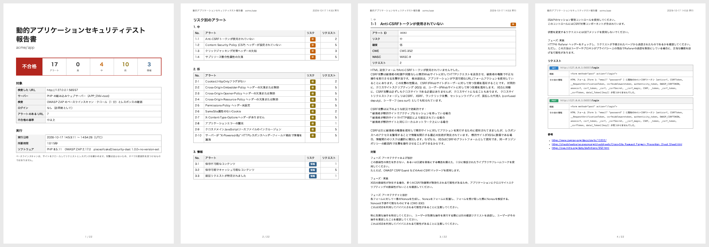

# Security DAST ドキュメント

CakePHP 2 アプリケーションの動的アプリケーションセキュリティテスト (DAST) です。アプリケーションを起動し、
[OWASP ZAP](https://www.zaproxy.org/) でスキャンします。ベースラインスキャンは、セキュリティヘッダーの不足、フラグのない
Cookie、CSRF トークンのないフォーム、デバッグ情報を出すエラーページなど、レスポンスからわかる問題を調べます。フル
スキャンは、さらにページやフォームを攻撃して、XSS や SQL インジェクションなどを調べます。ZAP はユーザーとして
ログインでき、クロールの代わりにプロジェクトの End-to-End テストをたどることもできます。
アラートはリスクごとの A4 の PDF の報告書にします。報告書は [pieceofcake2/report](https://pieceofcake2.github.io/report/ja/)
のデザインです。あるリスク以上のアラートがあれば、終了コードで CI を失敗にします。

- [アラート](alerts.md): 各アラートの意味と、CakePHP 2 アプリケーションでの直し方
- [GitHub Actions での CI](ci.md)

pieceofcake2 のセキュリティ診断の 1 つで、ほかに [pieceofcake2/security-sca](https://pieceofcake2.github.io/security-sca/ja/)
(Composer のパッケージの既知の脆弱性) と [pieceofcake2/security-sast](https://pieceofcake2.github.io/security-sast/ja/)
(ソースコード) があります。pieceofcake2/security-check で、すべてを実行できます。

## しくみ

1. プロジェクトのアプリケーションを、PHP の組み込みウェブサーバーで `127.0.0.1` に `APP_ENV=test` で起動します。
   アプリケーションは `config/.env.test` を読み、テストのデータベースを使います。ドキュメントルートはアプリケーションから
   取ります (`config/define.php` の `WWW_ROOT`、または `webroot/`、従来の構成では `app/webroot/`)。ルータースクリプトが、
   `webroot/.htaccess` と同じようにリクエストを `index.php` に渡します。
2. ZAP を Docker (`ghcr.io/zaproxy/zaproxy:stable`) で、Automation Framework の plan で実行します。サイトを 1 分間
   (`--minutes`) クロールし、各リクエストとレスポンスを確かめます (パッシブスキャン)。フルスキャンでは、続けて見つけた
   ページとパラメーターを攻撃します (アクティブスキャン)。ログインを指定すると、ZAP はまずブラウザでログインし、
   そのユーザーとしてクロールと攻撃をします。
3. ZAP の JSON の結果からアラートを読み、報告書の言語で PDF にします。`--language=ja` では、ZAP がアラートを日本語で
   書きます。

ZAP には CakePHP 2 のフォームの CSRF トークン (`SecurityComponent` の `data[_Token][key]`) を教えてあります。そうした
フォームをトークンのないフォームとして指摘せず、フルスキャンでは新しいトークンを付けて攻撃を送ります。

## 必要なもの

- PHP 8.0 以上
- Docker。ZAP のイメージ (約 1.5 GB) は初回に取得します。Linux ではコンテナがホストのネットワーク (`--network host`)
  を使い、macOS と Windows (Docker Desktop) では `host.docker.internal` からアプリケーションにアクセスします
- PDF の印刷に Google Chrome か Chromium 131 以上。日本語の報告書には、Linux では `fonts-noto-cjk`
- `APP_ENV=test` で動くアプリケーション。テーブルのあるデータベース (テストが読み込むスキーマなど) と `.env.test`

## インストール

```bash
composer require --dev pieceofcake2/security-dast
```

## 使い方

```bash
# プロジェクトのアプリケーションを、組み込みウェブサーバーで
vendor/bin/security-dast --pdf=tmp/security-dast.pdf --language=ja

# 起動済みのアプリケーション (ステージングのサーバーなど) を
vendor/bin/security-dast --url=https://staging.example.com --pdf=tmp/security-dast.pdf
```

コマンドは、まとめと報告書のパスを出力します。

```text
17 alerts (4 medium, 10 low, 3 info) on 7 URLs of http://127.0.0.1:56557 (ZAP 2.17.0). Report: tmp/security-dast.pdf
```

終了コードは、`--fail-on` に達するアラートがなければ `0`、あれば `1`、サーバー、スキャン、報告書のどれかが失敗したら
`2` です。

スキャンしてよいアプリケーションだけをスキャンしてください。ベースラインスキャンでも、サイトに多くのリクエストを
送ります。`--url` には自分のサーバーを指定し、他人のサイトには使わないでください。

### オプション

| オプション | 環境変数 | デフォルト | |
| --- | --- | --- | --- |
| `--pdf=PATH` | `SECURITY_DAST_PDF` | `tmp/security-dast.pdf` | PDF の報告書 |
| `--fail-on=RISK` | `SECURITY_DAST_FAIL_ON` | `high` | 不合格にする最も低いリスク。`high`、`medium`、`low`、`info`、`none` |
| `--project=DIR` | | カレントディレクトリ | アプリケーションのディレクトリ |
| `--url=URL` | `SECURITY_DAST_URL` | | 組み込みウェブサーバーの代わりにスキャンする、起動済みのアプリケーションの URL |
| `--webroot=DIR` | `SECURITY_DAST_WEBROOT` | アプリケーションの `WWW_ROOT` | 組み込みウェブサーバーのドキュメントルート |
| `--app-env=ENV` | `SECURITY_DAST_APP_ENV` | `test` | 組み込みウェブサーバーの `APP_ENV` |
| `--ignore=LIST` | `SECURITY_DAST_IGNORE` | | 報告書から除くアラート ID。カンマ区切り ([アラートを除外する](#アラートを除外する)) |
| `--scan=SCAN` | `SECURITY_DAST_SCAN` | `baseline` | `baseline`、またはページも攻撃する `full` ([スキャンの種類](#スキャンの種類)) |
| `--scan-minutes=N` | `SECURITY_DAST_SCAN_MINUTES` | `10` | フルスキャンの攻撃の最大の分数 |
| `--login-url=PATH` | `SECURITY_DAST_LOGIN_URL` | | ユーザーとしてスキャンするときのログインページ。パス (`/users/login`) か URL ([ログインしてスキャンする](#ログインしてスキャンする)) |
| `--username=NAME` | `SECURITY_DAST_USERNAME` | | ログインするユーザー |
| `--password=PASSWORD` | `SECURITY_DAST_PASSWORD` | | そのパスワード。環境変数で渡してください |
| `--exclude=LIST` | `SECURITY_DAST_EXCLUDE` | `.*logout.*` | 除く URL の正規表現 (Java のもの)。カンマ区切り |
| `--end-to-end=COMMAND` | `SECURITY_DAST_END_TO_END` | | クロールの代わりにスキャンする End-to-End テストのコマンド ([End-to-End テストをシナリオにする](#end-to-end-テストをシナリオにする)) |
| `--minutes=N` | `SECURITY_DAST_MINUTES` | `1` | サイトをクロールする分数 |
| `--ajax-spider=1` | `SECURITY_DAST_AJAX_SPIDER` | | JavaScript が作るリンクのために、ブラウザでもクロールします |
| `--zap-options=OPTIONS` | `SECURITY_DAST_ZAP_OPTIONS` | | ZAP のほかのオプション (`-config key=value ...`) |
| `--image=IMAGE` | `SECURITY_DAST_IMAGE` | `ghcr.io/zaproxy/zaproxy:stable` | ZAP の Docker イメージ。バージョンを固定するときなどに |
| `--docker=COMMAND` | `SECURITY_DAST_DOCKER` | `docker` | Docker のコマンド。`podman` など |
| `--language=LANG` | `SECURITY_REPORT_LANGUAGE` | `en` | `en` か `ja`、または `--locale-dir` の言語 |
| `--locale-dir=DIR` | `SECURITY_REPORT_LOCALE_DIR` | | メッセージを足したり置き換えたりする `<言語>.json` のディレクトリ |
| `--title=TITLE` | `SECURITY_DAST_TITLE` | 言語のタイトル | 報告書のタイトル |
| `--project-name=NAME` | `SECURITY_REPORT_PROJECT` | `composer.json` の名前 | タイトルの下のプロジェクト名 |
| `--note=TEXT` | `SECURITY_DAST_NOTE` | | 表紙の注記 |
| `--settings=FILE` | `SECURITY_SETTINGS` | `config/security.php` か `app/Config/security.php` | 設定ファイル |

### 設定ファイル

pieceofcake2 のセキュリティ診断の設定は、プロジェクトの `config/security.php` (従来の構成では `app/Config/security.php`)
にまとめられます。診断ごとのセクションと、共通の `report` セクションを持つ配列を返します。

```php
<?php
return [
    'report' => [
        'language' => 'ja',
        'dir' => 'tmp/security',
    ],
    'dast' => [
        'scan' => 'full',
        'failOn' => 'medium',
        'endToEnd' => 'vendor/bin/phpunit --testsuite EndToEnd',
        'loginUrl' => '/users/login',
        'username' => 'test@example.com',
        'password' => getenv('SECURITY_DAST_PASSWORD') ?: null,
        'ignore' => ['10049'],
    ],
];
```

`dast` セクションのキーは、オプションをキャメルケースにしたものです (`--fail-on` は `failOn`)。リストは配列で書きます。
`report` セクションには `language`、`localeDir`、`project` (プロジェクト名)、`note` と、報告書のディレクトリ `dir` が
あります (この例では `tmp/security/security-dast.pdf` に書き出します)。`dast` セクションに知らないキーがあると
エラーになります。オプションが環境変数より、環境変数が設定ファイルより優先されます。

## スキャンの種類

| | ベースライン (`--scan=baseline`、デフォルト) | フル (`--scan=full`) |
| --- | --- | --- |
| すること | クロールして、リクエストとレスポンスを確かめます | 同じことをしてから、各ページとパラメーターを攻撃します |
| 見つけるもの | セキュリティヘッダー、Cookie、トークンのないフォーム、エラーページ、ヘッダーのバージョンなど | 同じものと、XSS (反射型、持続型、DOM ベース)、SQL インジェクション、パストラバーサル、コマンドインジェクションなど |
| データの変更 | しません。ページを読むだけです | します。攻撃を入れたフォームを送るので、レコードを追加したり変更したりします |
| 実行する場所 | どの環境でも | テストのデータベースを使うテスト環境だけ |
| 時間 | 1、2 分ほど | 数分以上。攻撃は最大 `--scan-minutes` 分 (デフォルト 10) |

フルスキャンは攻撃者と同じものを送ります。スキャンの組み込みウェブサーバー (デフォルト、テストのデータベース) か、
データが消えてもよい自分のサーバーでだけ実行してください。本番では決して実行しないでください。

フルスキャンの攻撃は、レスポンスに出た影響で見つけます。そのため、すべての脆弱性を見つけるわけではなく、見つかった
ものもコードで確かめてください。コードは [pieceofcake2/security-sast](https://pieceofcake2.github.io/security-sast/ja/)
で調べます。

## ログインしてスキャンする

訪問者としてのクロールは、ログインページで止まります。アプリケーションのフォームの多くはその先にあります。テストの
データベースのユーザーを指定すると、ZAP はログインページでブラウザ (イメージの Firefox) を使ってログインし、その
ユーザーとしてクロールと攻撃をします。

```bash
export SECURITY_DAST_PASSWORD=secret
vendor/bin/security-dast --scan=full --login-url=/users/login --username=test@example.com
```

- ZAP は人と同じように、ページのユーザー名とパスワードの欄に入力します。そのため、`SecurityComponent` のトークン付きの
  `FormHelper` のフォームでもログインできます。
- ログインの保ち方 (セッションの Cookie) と、ログインしているかの確かめ方 (ログインで変わるページ) は、ZAP が自分で
  見つけます。ログアウトしたとわかると、もう一度ログインします。
- ログインできなかったときは、気づかないまま訪問者としてスキャンしないよう、エラー (終了コード `2`) になります。
  報告書の表紙には、ログインしたユーザーが載ります。
- スキャン中にログアウトしないよう、`.*logout.*` に合う URL は除きます。ほかのパターンは `--exclude` で指定します。
  例: `--exclude=.*/users/logout.*,.*/admin/.*`
- パスワードはオプションではなく `SECURITY_DAST_PASSWORD` (CI のシークレット) で渡してください。オプションはプロセスの
  一覧で見えてしまいます。パスワードは報告書には書きません。

スキャンのときに、そのユーザーがテストのデータベースにいる必要があります。フィクスチャーや、テスト環境のシードで
作ってください。

## End-to-End テストをシナリオにする

クロールは、ページのリンクをたどります。注文の確認画面のように、操作を順に重ねないとたどり着かないページは見落とす
ことがあり、フォームに正しい値を入れることもしません。プロジェクトの End-to-End テストは、こうしたシナリオを知って
います。`--end-to-end` を付けると、ZAP はクロールの代わりに、テストのリクエストを記録してスキャンします。

```bash
vendor/bin/security-dast --end-to-end="vendor/bin/phpunit --testsuite EndToEnd" --scan=full
```

1. ZAP をプロキシとして起動します (Docker の `zap.sh -daemon`)。`127.0.0.1` だけで待ち受け、API にはランダムな鍵を
   付けます。
2. テストのコマンドを、次の環境変数を付けて実行します。
   - `PANTHER_CHROME_ARGUMENTS`: テストの Chrome が ZAP のプロキシを使う設定 (`--proxy-server=...`)。すでにある引数に
     足します
   - `PANTHER_EXTERNAL_BASE_URI`: スキャンのアプリケーション。テストが自分のウェブサーバーを起動しないようにします
   - `APP_ENV`: スキャンのもの (`test`)
3. テストが終わったら、ZAP は記録したリクエストとレスポンスを確かめ、フルスキャンでは、テストのセッションの Cookie の
   まま攻撃します。

テストは [pieceofcake2/panther](https://pieceofcake2.github.io/panther/ja/) (または Symfony Panther) のものです。テストの
URL は相対パスで書いてください (`$client->request('GET', '/contacts/add')`)。ベース URI に従うようになります。テストの
出力は、コマンドのエラー出力に出ます。テストが失敗しても、それまでのリクエストでスキャンを続け、報告書の表紙にその
ことが載ります。`--login-url` も指定すると、フルスキャンの攻撃はそのユーザーとして行います。

制限があります。テストのブラウザから記録した `SecurityComponent` のフォームでは、フルスキャンの攻撃を
`SecurityComponent` が弾くことがあり、クロールのときより検査が少なくなることがあります。こうしたフォームのビューは、
[pieceofcake2/security-sast](https://pieceofcake2.github.io/security-sast/ja/) でも確かめてください。

## 報告書

- [見本の報告書 (日本語、PDF)](/report-sample-ja.pdf)
- [見本の報告書 (英語、PDF)](/report-sample.pdf)



1. **表紙**: 結果、リスクごとのアラートの数、リポジトリ、ブランチ、コミット、検査した URL、サーバー (組み込み
   ウェブサーバーとその `APP_ENV`、または起動済みのアプリケーション)、検査の内容、アラートのある URL の数、除外した
   アラート、不合格の基準、実行の日時、環境、ソフトウェア (ZAP とそのバージョン)
2. **リスク別のアラート**: 高、中、低、情報の順に、アラートとそのリクエストの数。それぞれのページへのリンク付き
3. **アラートごとのページ**: 名前、アラート ID、リスク、確度、CWE、WASC、意味と対策 (ZAP の説明)、見つかった各リクエスト
   (メソッド、URL と、ZAP が示すパラメーター、攻撃、根拠、その他の情報) を 50 件まで、参考リンク (最初に zaproxy.org の
   アラートのページ)

CakePHP 2 アプリケーションでの直し方は [アラート](alerts.md) をご覧ください。

## アラートを除外する

まずアラートを直してください。ほとんどは、`AppController` か Web サーバーで、アプリケーション全体に一度で直せます
([アラート](alerts.md))。アプリケーションの前のプロキシがセキュリティヘッダーを付けていて、組み込みウェブサーバーでは
付かない場合など、当てはまらないアラートは ID で報告書から除けます。

```bash
vendor/bin/security-dast --ignore=10038,10020
```

ID はその派生も除きます。`10038` で `10038-1` も除きます。ID は、報告書のアラート ID と
[ZAP のアラートの一覧](https://www.zaproxy.org/docs/alerts/) のものです。除外したアラートは、報告書の表紙に載ります。

## トラブルシューティング

**`ZAP failed (exit code 125): Cannot connect to the Docker daemon`**: Docker が動いていないか、そのユーザーが
使えません。

**`... has no index.php: give the document root with --webroot`**: ドキュメントルートが見つかりませんでした。
`--webroot` に、プロジェクトからの相対パスで指定してください。

**`PHP's built-in web server did not start`**: メッセージにサーバーの出力が出ます。ポートは空いているものを選ぶので、
拡張モジュールが足りないなど、PHP 自体が原因のことが多いです。

**すべてのページがエラー 500 になる**: アプリケーションが `APP_ENV=test` で動きません。テストのデータベースに
テーブルがないなどです。テストと同じようにスキーマを読み込んでからスキャンするか、別の `--app-env` を使ってください。
こうしたページは「アプリケーションエラーの露見」のアラートに出ます。

**ZAP が見つけた URL が少ない**: クロールはページのリンクをたどり、実行ごとに見つける数が少し変わります。`--minutes`
を増やすか、JavaScript が作るリンクのために `--ajax-spider=1` を付けるか、`--end-to-end` で End-to-End テストをスキャン
してください。

**`ZAP could not log in as ...`**: ユーザー名とパスワード、そのユーザーがテストのデータベースにいること、ログインページに
ほかの手順 (CAPTCHA や 2 段階認証など。テストのユーザーには付けないでください) がなく、ユーザー名とパスワードの欄が
あることを確かめてください。

**End-to-End テストがスキャンのときだけ失敗する**: テストは相対パスの URL を使い、`PANTHER_EXTERNAL_BASE_URI` に従う
必要があります。コマンドのエラー出力で、テストの出力を確かめてください。

**`Chrome is needed to print the report`**: Chrome か Chromium をインストールするか、`REPORT_CHROME_BINARY` を設定して
ください ([pieceofcake2/report](https://pieceofcake2.github.io/report/ja/))。
