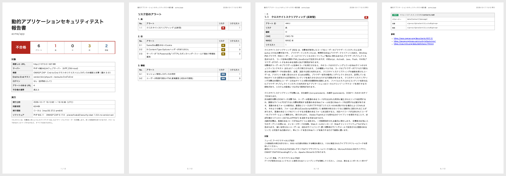

# 報告書

## 見本

**ベースラインスキャン**: セキュリティヘッダーのないページ、トークンのないフォーム、エラーページのあるサイトです。

- [ベースラインスキャンの見本 (日本語、PDF)](https://pieceofcake2.github.io/security-dast/report-sample-ja.pdf)
- [ベースラインスキャンの見本 (英語、PDF)](https://pieceofcake2.github.io/security-dast/report-sample.pdf)


**フルスキャン**: End-to-End テストをシナリオにした、CakePHP 2 アプリケーションです。`SecurityComponent` のフォームが
値を `h()` なしで出力していて、反射型の XSS として見つかります。

- [フルスキャンの見本 (日本語、PDF)](https://pieceofcake2.github.io/security-dast/report-sample-full-ja.pdf)
- [フルスキャンの見本 (英語、PDF)](https://pieceofcake2.github.io/security-dast/report-sample-full.pdf)



## ページ

1. **表紙**: 結果、リスクごとのアラートの数、リポジトリ、ブランチ、コミットと、スキャンの対象。URL、サーバー (組み込み
   ウェブサーバーとその `APP_ENV`、または起動済みのアプリケーション)、検査 (ベースラインかフルか、その時間)、
   End-to-End テストとその結果、ログインしたユーザー、アラートのある URL の数、除外したアラート、除外した URL (`--exclude`)、不合格の基準です。
   続けて、実行の日時、環境、ソフトウェア (ZAP とそのバージョン)
2. **リスク別のアラート**: 高、中、低、情報の順に、アラートとそのリクエストの数。それぞれのページへのリンク付き
3. **アラートごとのページ**: 名前、アラート ID、リスク、確度、CWE、WASC、意味と対策 (ZAP の説明を報告書の言語で)、
   見つかった各リクエストを 50 件まで、参考リンク (最初に zaproxy.org のアラートのページ)
4. **除外したアラート**: `--ignore` で除いたものがあるとき。それぞれの ID、名前、リスク、URL の数
   ([アラートを除外する](#アラートを除外する))

各リクエストには、メソッドと URL に続けて、ZAP が見つけたものが載ります。

| | |
| --- | --- |
| パラメーター | アラートのパラメーター、ヘッダー、Cookie。`data[Contact][message]` など |
| 攻撃 | ZAP が送った値。フルスキャンのアラートのもの |
| 根拠 | レスポンスに表れたもの。送った攻撃がそのまま出力されたもの、足りないヘッダーなど |
| その他の情報 | ZAP のそのほかの詳細 |

CakePHP 2 アプリケーションでの修正方法は [アラート](alerts.md) をご覧ください。

## リスクと確度

**リスク**は、問題が本物だったときの深刻さです。高 (XSS、SQL インジェクションなど)、中 (CSP やクリックジャッキング
対策のヘッダーの不足など)、低 (`SameSite` のない Cookie など)、情報 (知っておくもの。修正することはまれ) があります。
**確度**は、ZAP が問題を本物と考える確からしさで、低、中、高、確認済みがあります。確度が低のアラートは、修正する前に
コードで確かめてください。誤検知のことがあります。

`--fail-on` は、確度に関係なく、リスクで不合格にします。

| `--fail-on` | 不合格になるもの |
| --- | --- |
| `high` (デフォルト) | 高 |
| `medium` | 高と中 |
| `low` | 高、中、低 |
| `info` | すべてのアラート |
| `none` | なし。報告のみ |

既存のアプリケーションでは、まず `--fail-on=none` で報告書のアラートを修正し、それから基準を上げてください。

## アラートを除外する

まずアラートを修正してください。ほとんどは、`AppController` か Web サーバーで、アプリケーション全体に一度で修正できます
([アラート](alerts.md))。当てはまらないアラートは、ID で報告書から除けます。

```bash
vendor/bin/security-dast --ignore=10038,10020
```

- ID はその派生も除きます。`10038` で `10038-1` も除きます。
- ID は、報告書のアラート ID と、[ZAP のアラートの一覧](https://www.zaproxy.org/docs/alerts/) のものです。
- 忘れないよう、スキャンで出た除外したアラートも報告書に載ります。表紙に ID、「除外したアラート」のグループに
  それぞれの名前、リスク、URL の数です。不合格にはならず、コマンドのまとめにも件数が出ます。

除くのは、アプリケーションではなくスキャンの環境のアラートです。本番の前のプロキシが付けるセキュリティヘッダーで、
スキャンの組み込みウェブサーバーにはないものや、CI の PHP の `X-Powered-By` などです。理由は
[設定ファイル](configuration.md#設定ファイル)に残してください。

```php
'dast' => [
    // 本番のロードバランサーが CSP と X-Frame-Options を付ける。ステージングで --url で確認済み
    'ignore' => ['10038', '10020'],
],
```
