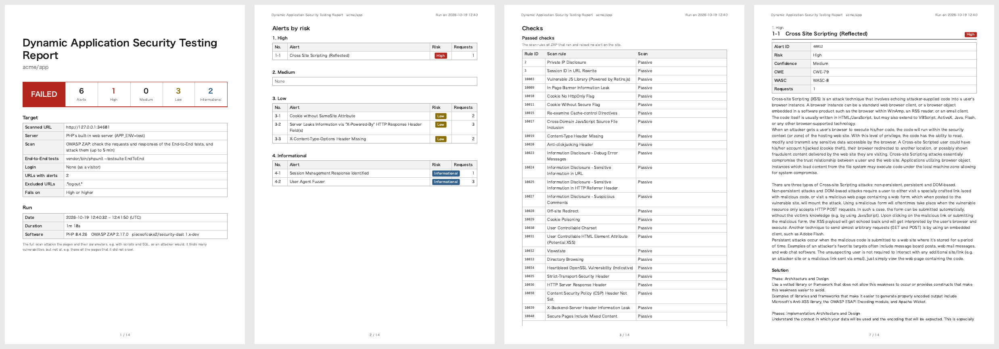

# The Report

## Samples

**The baseline scan** of a page without the security headers, with a form without a token and an error page:

- [Sample report of the baseline scan (English, PDF)](https://pieceofcake2.github.io/security-dast/report-sample.pdf)
- [Sample report of the baseline scan (Japanese, PDF)](https://pieceofcake2.github.io/security-dast/report-sample-ja.pdf)


**The full scan** of a CakePHP 2 application, with an End-to-End test as the scenario: a form with the token of
`SecurityComponent` that prints its value without `h()`, found as a reflected XSS:

- [Sample report of the full scan (English, PDF)](https://pieceofcake2.github.io/security-dast/report-sample-full.pdf)
- [Sample report of the full scan (Japanese, PDF)](https://pieceofcake2.github.io/security-dast/report-sample-full-ja.pdf)



The samples are built from the recorded scans of fictional applications with
[docs/examples/report-sample.php](https://github.com/pieceofcake2/security-dast/blob/1.x/docs/examples/report-sample.php);
the Samples workflow records the scans again with ZAP.

## The Pages

1. **Cover**: the result, the numbers of alerts by risk, the repository, branch and commit, and what was
   scanned: the URL, the server (the built-in web server and its `APP_ENV`, or a running application), the scan
   (baseline or full, its minutes), the End-to-End tests and their result, the user of the login, the number of
   URLs with alerts, the ignored alerts, the excluded URLs (`--exclude`) and the threshold; then the date, environment and software of the run
   (ZAP and its version)
2. **Alerts by risk**: High, Medium, Low and Informational, also without alerts (`None`); each alert with its
   number of requests, and a link to its page. **Ignored alerts**, when `--ignore` left some out: each with its
   ID, name, risk, number of URLs and the reason of the settings file ([Ignoring an Alert](#ignoring-an-alert))
3. **Checks**: the scan rules of ZAP, by their ID (the ID of their alerts)
   - **Passed checks**: the rules that ran and raised no alert on the site, passive or active
   - **Not run**: the active rules that ZAP skipped (not for the technology of the site, no page to attack, or a
     time limit), and, for the baseline scan, the rules of the active scan, which it does not run. When the active
     scan reaches its time limit (`--scan-minutes`), the rules that it had not started are not listed, and the
     note says so
4. **A page for each alert**: its name, alert ID, risk, confidence, CWE and WASC, what it means and how to fix
   it (as ZAP writes them, in the language of the report), each request where it was found, up to 50, and the
   links: the page of the alert on zaproxy.org first

ZAP lists the rules that ran in the passing rules of its `modern` report (the data of the jobs of the passive and
active scans), and the skipped ones in the statistics of its `traditional-json-plus` report: the plan writes both
to the directory of the scan, besides the alerts. A rule that raised alerts on another site only, e.g. a CDN that
the browser of a scenario reached through the proxy, is in neither list.

Each request shows its method and URL, then what ZAP found in it:

| | |
| --- | --- |
| Parameter | The parameter, header or cookie of the alert, e.g. `data[Contact][message]` |
| Attack | The value that ZAP sent, for the alerts of the full scan |
| Evidence | What the response showed, e.g. the attack printed as it was sent, or the header that is missing |
| Other info | More details of ZAP |

See [Alerts](alerts.md) for the fixes of the alerts in a CakePHP 2 application.

## Risk and Confidence

The **risk** is how bad the issue is when it is real: High (e.g. XSS, SQL injection), Medium (e.g. a missing
CSP or anti-clickjacking header), Low (e.g. a cookie without `SameSite`), and Informational (to know, rarely to
fix). The **confidence** is how sure ZAP is that the issue is real: Low, Medium, High or Confirmed. Check an
alert of low confidence in the code before fixing it: it can be a false positive.

`--fail-on` fails the run on a risk, whatever the confidence:

| `--fail-on` | Fails on |
| --- | --- |
| `high` (default) | High |
| `medium` | High and Medium |
| `low` | High, Medium and Low |
| `info` | Every alert |
| `none` | Nothing: the report only |

For an existing application, start with `--fail-on=none`, fix the alerts of the report, then raise the
threshold.

## Ignoring an Alert

Fix the alerts first: most of them are fixed once for the whole application, in `AppController` or the web
server ([Alerts](alerts.md)). When an alert does not apply, leave it out of the report with its ID:

```bash
vendor/bin/security-dast --ignore=10038,10020
```

- An ID leaves out its variants too: `10038` leaves out `10038-1`.
- The IDs are those of the report (Alert ID) and of [the alerts of ZAP](https://www.zaproxy.org/docs/alerts/).
- The report still lists the ignored alerts that the scan raised, so that they are not forgotten: their IDs on
  the cover, and a group "Ignored alerts" with the name, risk, number of URLs and reason of each. They do not fail the
  scan, and the summary of the command counts them.

The alerts to ignore are those of the scan environment, not of the application: e.g. the security headers that
a proxy in front of production adds, which the built-in web server of the scan does not have, or the
`X-Powered-By` of the PHP of CI. Give the reason of each ID in the [settings file](configuration.md#the-settings-file):
the report shows it with the alert.

```php
'dast' => [
    'ignore' => [
        '10038' => 'The load balancer of production adds the CSP; checked on staging with --url',
        '10020' => 'The load balancer of production adds X-Frame-Options; checked on staging with --url',
    ],
],
```

A list of IDs without reasons, `'ignore' => ['10038', '10020']`, works too; give either a reason for every ID or
none, as PHP numbers the IDs without a key after those with one. `--ignore` and `SECURITY_DAST_IGNORE` take IDs
only, and replace the IDs of the file.
